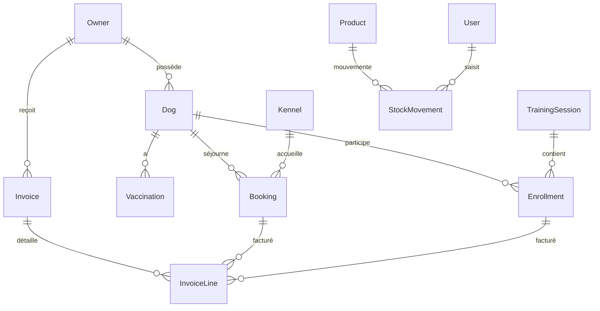

# Amour 2 Poils · Back-office

Back-office de gestion de la pension canine **Amour 2 Poils** (éducation positive, pension et petsitting).
Projet réalisé dans le cadre du TP de Front-end avancé (M1).

Site vitrine existant, dont ce back-office reprend la direction artistique : <https://robintijou49.github.io/Amour2Poils/>

---

## Phase 1 · Choix et préparation

### Identité

| | |
|---|---|
| **Nom** | Robin Tijou |
| **Dépôt** | <https://github.com/RobinTijou49/Amour2Poils-backoffice> |
| **IA utilisée** | Claude Code (Anthropic) |
| **Méta-framework** | Next.js 16 (App Router) + TypeScript |
| **Interpréteur ECMAScript** | Bun 1.4 |
| **Base de données** | PostgreSQL 17 + Prisma ORM 7 |
| **Thème présenté à l'oral** | Thème 6 · PWA et ses possibilités |

### Thématique

Amour 2 Poils accueille des chiens en pension, fait du petsitting à domicile et donne des cours d'éducation
positive. Aujourd'hui, le site vitrine présente l'activité mais toute la gestion se fait à la main
(agenda papier, tableur, messages). Le back-office centralise cette gestion.

**Utilisateurs**

- **Gérant·e (rôle ADMIN)** : accès complet, facturation, paramétrage des boxes et des tarifs.
- **Employé·e (rôle EMPLOYEE)** : planning du jour, arrivées et départs, fiches des chiens, sorties de stock.
  Utilise surtout un téléphone, parfois sans réseau dans les espaces extérieurs.

**Problèmes réglés**

- Savoir en un coup d'œil quels chiens arrivent, partent ou sont présents aujourd'hui, et quelles boxes sont libres.
- Avoir sous la main les informations sensibles de chaque chien : allergies, régime, comportement, vétérinaire,
  vaccins à jour ou non.
- Ne plus tomber en rupture de croquettes : suivi du stock et alerte de seuil bas.
- Facturer les séjours et les séances sans ressaisie.

### Fonctionnalités par module

| Module | Indispensable | Bonus |
|---|---|---|
| **Réservations pension** | Calendrier des séjours, attribution d'une box, statuts (en attente, confirmée, en cours, terminée, annulée), check-in / check-out, refus si la box est pleine | Glisser-déposer dans le planning (avec alternative clavier), tarif dégressif |
| **Clients et chiens** | Fiches propriétaires et chiens, vaccins avec date d'expiration, allergies, régime, notes de comportement, vétérinaire | Photos, historique des séjours par chien |
| **Stock** | Produits, entrées / sorties, seuil d'alerte, historique des mouvements | Sortie automatique des repas selon les chiens présents |
| **Facturation** | Facture générée depuis une réservation ou une séance, numérotation, statut de paiement | Export PDF, paiement en ligne (mode test) |
| **Séances éducation et petsitting** | Planning des cours (particulier, collectif, puppy class) et des visites, inscriptions | Feuille de présence |
| **Tableau de bord** | Arrivées / départs du jour, taux d'occupation, alertes stock et vaccins | Graphiques mensuels |
| **PWA** | Installable, planning du jour et fiches chiens hors connexion, notifications push (nouvelle réservation, stock bas, vaccin expiré) | Check-in hors ligne synchronisé au retour du réseau |

### Modèle de données

Défini dans [`prisma/schema.prisma`](prisma/schema.prisma).



Les montants sont en centimes (`Int`) pour éviter les erreurs d'arrondi des nombres flottants.

### Justification des choix techniques

- **Next.js** : le méta-framework le plus utilisé. Il permet dans une même application le rendu côté client,
  côté serveur, statique et les Server Components, ce qui est nécessaire pour la comparaison CSR / SSR / SSG de la
  phase 3. Le backend intégré (Route Handlers et Server Actions) suffit pour l'API du back-office.
- **Bun** : interpréteur rapide, TypeScript exécuté sans étape de compilation, gestionnaire de paquets et test runner
  intégrés, hachage de mots de passe argon2id natif (`Bun.password`). Next.js est lancé avec `bun --bun` pour
  utiliser réellement Bun comme runtime, pas seulement comme gestionnaire de paquets.
- **PostgreSQL + Prisma** : base relationnelle adaptée aux relations du domaine (clients, chiens, séjours, factures),
  schéma typé et migrations versionnées. Prisma 7 se connecte via l'adaptateur `@prisma/adapter-pg`.
  La CLI est fixée en 7.10.1 : le tag `latest` de npm pointe vers une version 8 en release candidate.
- **Tailwind CSS 4** : les tokens de la DA du site vitrine sont déclarés une fois dans
  [`globals.css`](src/app/globals.css) et réutilisés partout.
- **Claude Code** : utilisé pour le scaffolding, la revue de code et le refactoring. Les règles de travail sont dans
  [`CLAUDE.md`](CLAUDE.md) et chaque usage notable est consigné dans le [journal IA](docs/journal-ia.md).

---

## Phase 2 · Maquette Figma

Maquette : <https://www.figma.com/design/2ju0WFXMpBtETVELEKz6Ee>

| Page Figma | Contenu |
|---|---|
| **Design system** | Palette clair / sombre avec ratios de contraste, échelle typographique, 17 icônes, composants (Bouton, Champ, Badge, Élément de menu, Carte KPI, Avatar chien, Barre latérale) |
| **Écrans · Desktop** (1440 × 900) | Connexion, Tableau de bord, Réservations (planning des boxes), Fiche chien, Stock, Facturation, Séances |
| **Écrans · Mobile** (390 × 844) | Journée en mode hors connexion, Enregistrement d'une arrivée, Fiche chien |

**Choix de design**

- La DA du site vitrine est conservée (crème, sauge, brun, Quicksand + Nunito). Les variables Figma portent
  les mêmes noms que les variables CSS de [`globals.css`](src/app/globals.css) : la maquette et le code
  partagent une seule source de tokens.
- **Contraste** : le vert sauge du site (`#6f7f64`) n'atteint que 4,2:1 sur le fond, sous le seuil AA de 4,5:1.
  Le back-office utilise un `primary` assombri (`#5f6e55`, 5,3:1 ; texte blanc dessus 5,5:1). Tous les couples
  texte / fond de statut dépassent 5:1. La bordure des champs (`border-strong`) atteint 3:1 (WCAG 1.4.11).
- **Accessibilité intégrée dès la maquette** : boutons et champs de 44 px de haut (WCAG 2.5.8), étiquettes
  toujours visibles, statuts écrits en toutes lettres et pas seulement en couleur (WCAG 1.4.1), onglet actif
  signalé par un fond et pas seulement par la couleur du texte.
- **Mobile terrain** : les écrans mobiles anticipent la PWA (bandeau hors connexion, arrivée enregistrée
  sans réseau puis synchronisée).
- **Limites du plan Figma gratuit** : 3 pages maximum et un seul mode par collection de variables.
  Le thème sombre est donc une seconde collection « Couleurs · Sombre » au lieu d'un mode.

### De la maquette au code

| Route | Écran |
|---|---|
| `/` | Tableau de bord |
| `/reservations?semaine=AAAA-MM-JJ` | Planning des boxes |
| `/chiens`, `/chiens/[id]` | Liste et fiche chien |
| `/stock`, `/facturation`, `/seances` | Stock, factures, séances |
| `/connexion` | Connexion (visuel, l'authentification arrive ensuite) |

- Composants dans [`src/components/ui`](src/components/ui), un par composant Figma (Bouton, Champ, Badge, Carte, Tableau, Icônes).
- Coquille commune dans le route group [`src/app/(backoffice)`](src/app/(backoffice)/layout.tsx) : lien
  « Aller au contenu », barre latérale sur desktop, barre d'onglets en bas sur mobile, `aria-current="page"`.
- Données lues avec Prisma dans des Server Components ([`src/lib/queries.ts`](src/lib/queries.ts)).
  Avec `cacheComponents`, chaque requête appelle `connection()` et s'affiche dans un `<Suspense>` :
  la coquille est prérendue, les données sont streamées (*Partial Prerendering*).

### Authentification et rôles

Sessions maison, sans bibliothèque, pour maîtriser et expliquer chaque mécanisme :

| Mécanisme | Où | Pourquoi |
|---|---|---|
| Mot de passe haché en argon2id (`Bun.password`) | [`actions.ts`](src/app/connexion/actions.ts), seed | Un mot de passe n'est jamais stocké en clair |
| Jeton de session aléatoire (32 octets), seule son empreinte SHA-256 en base | [`session.ts`](src/lib/session.ts) | Une fuite de la base ne permet pas d'usurper une session |
| Cookie `HttpOnly`, `SameSite=Lax`, `Secure` en production, 7 jours | [`session.ts`](src/lib/session.ts) | Illisible par JavaScript (XSS), non envoyé par les formulaires d'autres sites (CSRF) |
| Message d'erreur identique et temps de vérification constant | [`actions.ts`](src/app/connexion/actions.ts) | Ne révèle pas si une adresse e-mail a un compte |
| 5 échecs maximum en 15 minutes par adresse | table `LoginAttempt` | Freine les attaques par force brute |
| `proxy.ts` : redirection si pas de cookie | [`proxy.ts`](src/proxy.ts) | Vérification rapide, mais **pas** une sécurité |
| Vérification de la session dans chaque lecture de données | [`auth.ts`](src/lib/auth.ts), [`queries.ts`](src/lib/queries.ts) | Data Access Layer : aucune donnée sans utilisateur connecté |
| Rôles : Facturation réservée à la gérance (`forbidden()` → page 403) | [`auth.ts`](src/lib/auth.ts) | L'employé ne voit ni le lien ni les données |

Comptes de développement créés par le seed : voir `SEED_ADMIN_*` et `SEED_EMPLOYEE_*` dans `.env`.

---

## Lancer le projet

Prérequis : [Bun](https://bun.sh) ≥ 1.4 et Docker Desktop.

```bash
cp .env.example .env      # puis adapter les valeurs si besoin
bun install               # génère aussi le client Prisma
bun run db:up             # lance PostgreSQL (port 5433)
bun run db:migrate        # applique les migrations
bun run db:seed           # données de démonstration fictives
bun run dev               # http://localhost:3000
```

Vérifier que l'API et la base répondent : <http://localhost:3000/api/health>

### Scripts

| Script | Rôle |
|---|---|
| `dev` / `build` / `start` | Next.js exécuté par Bun |
| `lint` / `typecheck` | ESLint et vérification TypeScript |
| `db:up` / `db:down` | Démarre ou arrête PostgreSQL (Docker) |
| `db:migrate` | Crée et applique une migration après modification du schéma |
| `db:generate` | Régénère le client Prisma |
| `db:seed` / `db:reset` | Remplit la base / la réinitialise |
| `db:studio` | Interface Prisma Studio |

## Structure

```
prisma/              schéma, migrations, seed
src/app/             routes Next.js (pages et API)
src/lib/             code serveur partagé (client Prisma…)
src/generated/       client Prisma généré (non versionné)
docs/                suivi du projet (todo list, journal IA)
```

## Suivi

- Todo list du TP : <https://claude.ai/artifact/RJq6bfB3CYz1hfetKG7qG3> (source : [`docs/todo-tp.html`](docs/todo-tp.html))
- Journal d'utilisation de l'IA : [`docs/journal-ia.md`](docs/journal-ia.md)
